<!-- ═══════════════════════════ HEADER ═══════════════════════════ -->
<p align="center">
  
</p>

<p align="center">
  <a href="https://readme-typing-svg.demolab.com?font=Fira+Code&weight=600&size=22&pause=1000&color=22D3EE&center=true&vCenter=true&width=700&lines=Full-Stack+Developer+%F0%9F%87%B7%F0%9F%87%BC;Building+with+TypeScript+%E2%80%A2+React+%E2%80%A2+Next.js;AI-powered+apps+%26+multi-LLM+systems;Open+to+work+%E2%80%94+let's+build+something+great!">
    
  </a>
</p>

<p align="center">
  <a href="https://nttare0.netlify.app"></a>
  <a href="mailto:nttare0@gmail.com"></a>
  <a href="https://github.com/nttare0?tab=followers"></a>
  
</p>

---

## 👨‍💻 About Me

```typescript
const ntare = {
  name: "Ntare Shema Prince",
  location: "Rwanda 🇷🇼",
  role: "Full-Stack Developer",
  stack: ["TypeScript", "React", "Next.js", "Node.js", "Python"],
  focus: ["AI-powered products", "Multi-LLM systems", "Modern web apps"],
  portfolio: "https://nttare0.netlify.app",
  openToWork: true,
};
```

- 🔭 Currently building **Synapse** — a multi-LLM research & coding IDE where AI agents collaborate on a single task
- 🤖 Passionate about **AI tooling**: multi-model orchestration, agent workflows, and making LLMs write like humans
- 🌱 Deepening my expertise in **cloud architecture & scalable backends**
- 💼 **Open to work** — freelance, contract, or full-time opportunities
- 📫 Reach me at **[nttare0@gmail.com](mailto:nttare0@gmail.com)** or through my **[portfolio](https://nttare0.netlify.app)**

---

## 🛠️ Tech Stack

<p align="center">
  
</p>

<p align="center">
  
  
  
  
  
  
</p>

---

## 🚀 Featured Projects

<p align="center">
  <a href="https://github.com/nttare0/playground">
    
  </a>
  <a href="https://github.com/nttare0/mark2-ai-system">
    
  </a>
</p>
<p align="center">
  <a href="https://github.com/nttare0/tool-kit">
    
  </a>
  <a href="https://github.com/nttare0/prince-shema-portfolio">
    
  </a>
</p>

| Project | What it is |
|---|---|
| 🧠 **[playground — Synapse](https://github.com/nttare0/playground)** | Multi-LLM research & coding IDE: several AI agents propose, critique, and synthesize solutions, then write code into an in-browser IDE — with an admin console for real provider APIs (Claude, OpenAI, Gemini). |
| 🤖 **[mark2-ai-system](https://github.com/nttare0/mark2-ai-system)** | AI system built with Next.js & TypeScript. |
| 🧰 **[tool-kit](https://github.com/nttare0/tool-kit)** | My largest TypeScript codebase — a growing collection of developer tools & utilities. |
| 🎨 **[prince-shema-portfolio](https://github.com/nttare0/prince-shema-portfolio)** | Personal portfolio built with React, Vite, TypeScript, shadcn-ui & Tailwind CSS. |
| ✍️ **[skill](https://github.com/nttare0/skill)** | An AI skill that makes LLM output read naturally human, based on Wikipedia's *Signs of AI writing* field guide. |
| 🌐 **[konet-vision-reality](https://github.com/nttare0/konet-vision-reality)** | TypeScript web experience exploring vision & reality interfaces. |

---

## 📊 GitHub Stats

<p align="center">
  
  
</p>

<p align="center">
  
</p>

<p align="center">
  
</p>

---

## 🐍 Contribution Snake

<p align="center">
  
</p>

> ⚙️ The snake is auto-generated by the [GitHub Actions workflow](.github/workflows/snake.yml) in this repo — it activates after this profile is merged to `main` and runs daily.

---

## 🤝 Connect With Me

<p align="center">
  <a href="https://nttare0.netlify.app"></a>
  <a href="mailto:nttare0@gmail.com"></a>
  <a href="https://github.com/nttare0"></a>
</p>

<p align="center">
  <i>“First, solve the problem. Then, write the code.”</i> — John Johnson
</p>

<p align="center">
  
</p>
